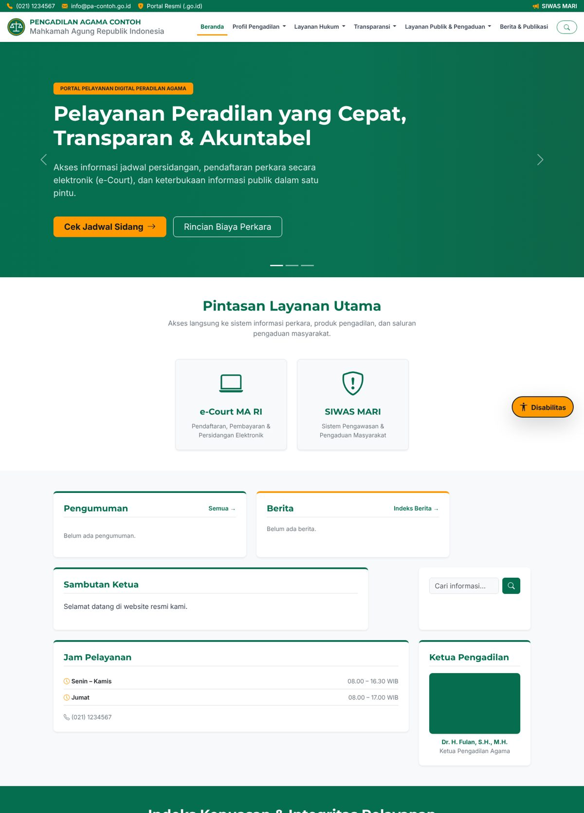
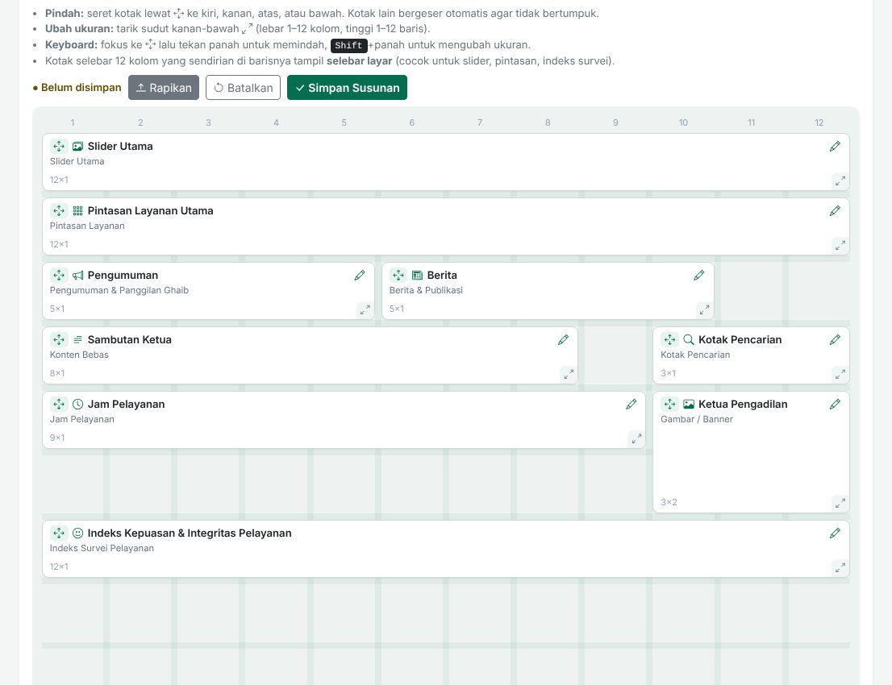
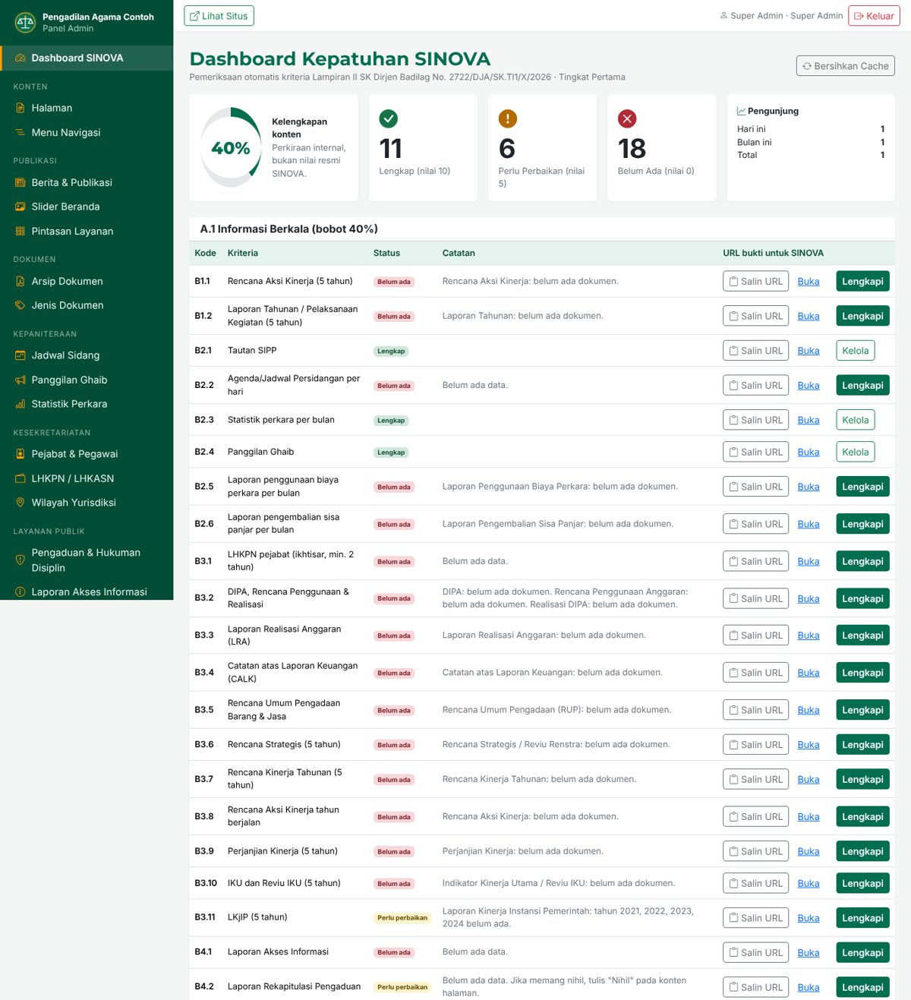
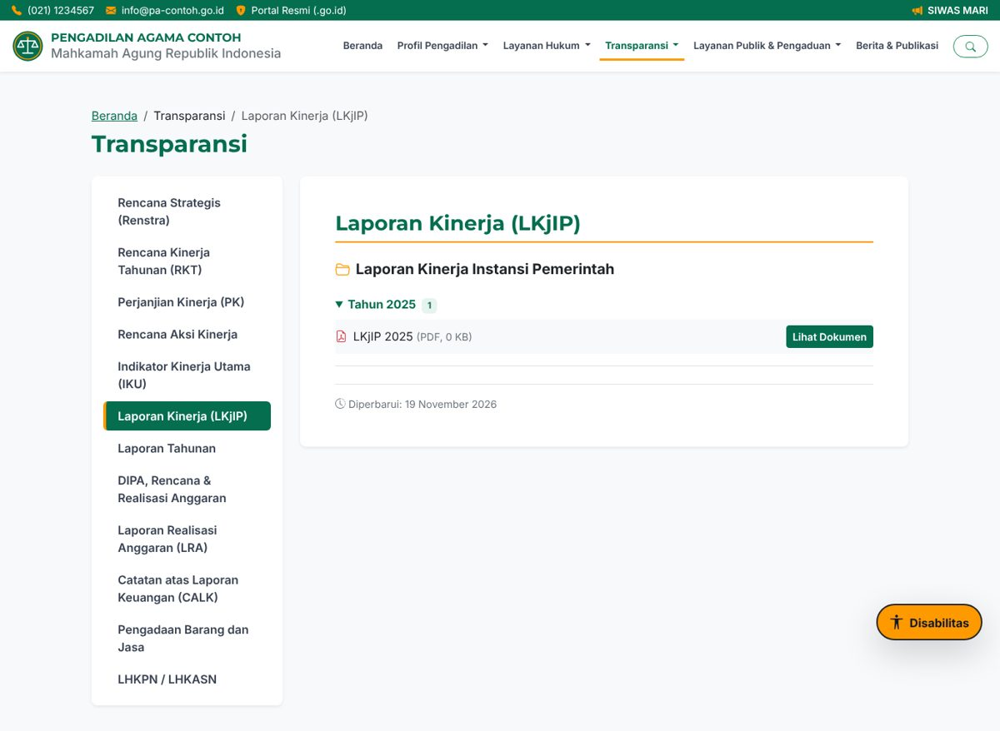

# Website Satker Peradilan Agama

Aplikasi website satuan kerja Peradilan Agama yang **open source**, dibangun dengan **CodeIgniter 4** dan mengikuti
**SK Dirjen Badilag No. 2722/DJA/SK.TI1/X/2026** tentang Petunjuk Teknis Pembaruan, Tata Kelola, dan Evaluasi Website Satuan Kerja di Lingkungan Peradilan Agama.

[](LICENSE)


> Proyek komunitas, **bukan** produk resmi Mahkamah Agung RI / Ditjen Badilag. Tampilan mengacu pada template website satker dari Badilag;
> logo resmi Mahkamah Agung RI **tidak disertakan** dan diunggah sendiri oleh tiap satker lewat panel admin.

| Beranda | Editor Tampilan Beranda |
|---|---|
|  |  |
| **Dashboard Kepatuhan SINOVA** | **Halaman per kriteria** |
|  |  |

---

## Daftar Isi

1. [Fitur](#fitur)
2. [Persyaratan](#persyaratan)
3. [Instalasi di Windows (XAMPP) — untuk uji coba](#instalasi-di-windows-xampp--untuk-uji-coba)
4. [Instalasi di Server Linux — untuk produksi](#instalasi-di-server-linux--untuk-produksi)
5. [Langkah pertama setelah instalasi](#langkah-pertama-setelah-instalasi)
6. [Memperbarui aplikasi](#memperbarui-aplikasi)
7. [Lupa password / ponsel MFA hilang](#lupa-password--ponsel-mfa-hilang)
8. [Keamanan & checklist server](#keamanan--checklist-server)
9. [Struktur & pengembangan](#struktur--pengembangan)
10. [Kontribusi, lisensi & kredit](#kontribusi-lisensi--kredit)

---

## Fitur

### Situs publik
- **6 menu utama** sesuai Bab III huruf F, dengan menu yang dinamis dari panel admin.
- **Satu URL tetap per kriteria SINOVA** (mis. `/transparansi/lkjip`), sehingga screenshot otomatis SINOVA langsung menampilkan isinya.
- **Warna resmi** `#056e4f` / `#ff9900` dikunci.
- **Widget disabilitas**: pembaca layar (suara), kontras tinggi, perbesar teks. Pilihan pengguna tersimpan antar halaman.
- **Pencarian internal** halaman, berita, dan dokumen.
- **Statistik pengunjung**: IP disimpan sebagai hash.
- Banner **Informasi Serta Merta**.
- **Cepat & aman**: semua aset di-host sendiri (tanpa CDN), gambar otomatis dikompres ke WebP, PDF disajikan dari luar folder publik.

### Panel admin
| Modul | Keterangan |
|---|---|
| **Dashboard Kepatuhan SINOVA** | Cek otomatis 35 kriteria Lampiran II (menyesuaikan PA/PTA), tombol *Salin URL* untuk diinput ke SINOVA |
| **Tampilan Beranda** | Editor grid bebas 12 kolom: seret kotak ke mana saja, tarik sudut untuk ubah lebar & tinggi, 13 jenis blok |
| **Halaman** | Isi berbasis blok yang bisa diseret: **teks**, **tabel** (tempel langsung dari Excel; kolom tautan tampil sebagai tombol *Lihat* dengan pratinjau Google Drive/Docs di popup), **gambar**, dan **sematan** (Google Drive, Docs/Sheets/Slides/Form, YouTube, PDF, Google Maps, atau halaman website lain). Ditambah modul data. Halaman wajib SK dikunci alamatnya; perubahan alamat halaman lain otomatis dialihkan (301) |
| **Menu Navigasi** | Label, urutan, sub-menu hingga 3 level, tautan internal/luar |
| **Arsip Dokumen** | SAKIP (Renstra, RKT, PK, IKU, LKjIP), keuangan (DIPA, LRA, CALK), RUP, laporan bulanan, SK panjar, survei |
| **Data** | Berita, slider (maks. 5), pintasan, jadwal sidang, panggilan ghaib, statistik perkara, pegawai, LHKPN, wilayah, pengaduan/hukuman disiplin, laporan akses informasi |
| **Pengguna & Peran** | Super Admin, Admin Konten, Operator Kepaniteraan / Kesekretariatan / Humas |
| **Keamanan** | Login dengan **MFA (TOTP)** wajib, pembatasan percobaan, CSRF, HTMLPurifier, log aktivitas |

---

## Persyaratan

| Komponen | Versi |
|---|---|
| PHP | **8.2 atau lebih baru**, dengan ekstensi `intl`, `mbstring`, `gd` (mendukung WebP), `mysqli`, `json`, `fileinfo` |
| Database | MariaDB 10.4+ atau MySQL 8+ |
| Composer | 2.x — <https://getcomposer.org/download/> |
| Web server | Apache 2.4 (mod_rewrite) atau Nginx |

---

## Instalasi di Windows (XAMPP) — untuk uji coba

> Cocok untuk mencoba di komputer kantor sebelum dipasang di server.

**1. Pasang perangkat lunak**
- [XAMPP](https://www.apachefriends.org/) dengan PHP 8.2 atau lebih baru.
- [Composer](https://getcomposer.org/Composer-Setup.exe). Saat instalasi pilih `C:\xampp\php\php.exe`.
- [Git](https://git-scm.com/download/win) (opsional, bisa juga unduh ZIP).

**2. Aktifkan ekstensi `intl`**
Buka `C:\xampp\php\php.ini`, cari `;extension=intl`, hapus titik koma di depannya, simpan, lalu restart Apache dari XAMPP Control Panel.

**3. Ambil kode**
```bat
cd C:\xampp\htdocs
git clone https://github.com/rohmansyah1228/website-satker-pengadilan-agama.git website-satker
cd website-satker
composer install
```
(Tanpa Git: unduh ZIP dari tombol **Code → Download ZIP**, ekstrak ke `C:\xampp\htdocs\website-satker`, lalu jalankan `composer install` di folder tersebut.)

**4. Buat database**
Jalankan MySQL di XAMPP Control Panel, buka <http://localhost/phpmyadmin>, buat database baru bernama `website_satker` dengan collation `utf8mb4_unicode_ci`.

**5. Atur konfigurasi**
```bat
copy .env.example .env
php spark key:generate
```
Buka `.env` dengan Notepad dan sesuaikan untuk komputer lokal:
```ini
CI_ENVIRONMENT = development
app.baseURL = 'http://localhost:8080/'
app.forceGlobalSecureRequests = false
cookie.secure = false

database.default.hostname = 127.0.0.1
database.default.database = website_satker
database.default.username = root
database.default.password =
```

**6. Buat tabel & data awal**
```bat
php spark migrate
php spark db:seed SatkerSeeder
```
Terminal akan menampilkan **password Super Admin** (username `admin`). **Catat**, karena password ini hanya ditampilkan sekali.

**7. Jalankan**
```bat
php spark serve
```
- Situs: <http://localhost:8080>
- Panel admin: <http://localhost:8080/panel-satker/login>

Pada login pertama, sistem meminta Anda mengaktifkan **MFA**. Siapkan aplikasi *Google Authenticator* / *Microsoft Authenticator* di ponsel.

> `php spark serve` harus tetap berjalan. Alternatifnya, buat VirtualHost Apache yang mengarah ke folder `public` (contoh di `deploy/apache-satker.conf`).

---

## Instalasi di Server Linux — untuk produksi

Contoh untuk **Ubuntu 24.04 LTS** + Nginx + MariaDB.

**1. Paket sistem**
```bash
sudo apt update
sudo apt install -y nginx mariadb-server git unzip \
  php8.3-fpm php8.3-cli php8.3-intl php8.3-mbstring php8.3-gd php8.3-mysql php8.3-xml php8.3-curl
curl -sS https://getcomposer.org/installer | php && sudo mv composer.phar /usr/local/bin/composer
```

**2. Database & akun khusus** (jangan memakai root, SK Bab II huruf E)
```bash
sudo mariadb
```
```sql
CREATE DATABASE website_satker CHARACTER SET utf8mb4 COLLATE utf8mb4_unicode_ci;
CREATE USER 'web_satker'@'localhost' IDENTIFIED BY 'GANTI-dengan-password-kuat';
GRANT SELECT, INSERT, UPDATE, DELETE, CREATE, ALTER, INDEX, DROP ON website_satker.* TO 'web_satker'@'localhost';
FLUSH PRIVILEGES;
```
Pastikan `bind-address = 127.0.0.1` di `/etc/mysql/mariadb.conf.d/50-server.cnf`.

**3. Kode aplikasi**
```bash
sudo git clone https://github.com/rohmansyah1228/website-satker-pengadilan-agama.git /var/www/website-satker
cd /var/www/website-satker
sudo composer install --no-dev --optimize-autoloader
sudo cp .env.example .env
sudo php spark key:generate
sudo nano .env      # isi app.baseURL (https://...go.id/), app.adminPath, kredensial database
```

**4. Tabel, data awal & hak akses folder**
```bash
sudo php spark migrate
sudo php spark db:seed SatkerSeeder     # catat password Super Admin
sudo chown -R www-data:www-data writable public/uploads
sudo chmod -R 750 writable
```

**5. Web server & HTTPS**
```bash
sudo cp deploy/nginx-satker.conf /etc/nginx/sites-available/website-satker
sudo nano /etc/nginx/sites-available/website-satker    # sesuaikan server_name, path sertifikat, versi PHP-FPM
sudo ln -s /etc/nginx/sites-available/website-satker /etc/nginx/sites-enabled/
sudo apt install -y certbot python3-certbot-nginx && sudo certbot --nginx -d www.pa-contoh.go.id
sudo nginx -t && sudo systemctl reload nginx
```
Document root **harus** folder `public/`. Contoh Apache ada di `deploy/apache-satker.conf`.

**6. Backup mingguan offsite** (SK Bab II huruf G)
```bash
sudo crontab -e
# 0 1 * * 0  /var/www/website-satker/deploy/backup-satker.sh
```
Lalu salin folder backup ke media/server lain (rclone/rsync).

---

## Langkah pertama setelah instalasi

1. **Login** di `https://domain-anda/<app.adminPath>/login` lalu **aktifkan MFA**.
2. **Akun Saya → Ganti Password**.
3. **Pengaturan → Identitas**: nama satker, tingkat (PA/PTA), **logo resmi MA RI**.
4. **Pengaturan → Alamat & Kontak**: alamat lengkap, telepon, email, **foto gedung**.
5. **Pengaturan → Tautan Layanan**: URL SIPP, URL Direktori Putusan satker.
6. Buka **Dashboard SINOVA**. Setiap kriteria punya status, tombol *Salin URL*, dan tombol *Lengkapi*.
7. Ganti semua teks bertanda **`[LENGKAPI]`** pada halaman bawaan.
8. Atur **Tampilan Beranda** sesuai selera. Kotak selebar 12 kolom yang sendirian di barisnya tampil selebar layar.

---

## Memperbarui aplikasi

```bash
cd /var/www/website-satker        # atau C:\xampp\htdocs\website-satker
git pull
composer install --no-dev --optimize-autoloader
php spark migrate
php spark cache:clear
```
Selalu **backup database** sebelum memperbarui.

---

## Lupa password / ponsel MFA hilang

```bash
php spark satker:reset-mfa admin              # reset MFA saja
php spark satker:reset-mfa admin --password   # reset MFA + buat password baru (ditampilkan di terminal)
```
Super Admin juga bisa mereset MFA pengguna lain dari menu **Pengguna**.

---

## Keamanan & checklist server

### Yang sudah ditangani aplikasi (Bab II)
| Ketentuan SK | Implementasi |
|---|---|
| B.3 Validasi input (SQLi/XSS) | Query Builder (parameter binding), validasi server, `esc()` di view, HTMLPurifier untuk isi editor, CSRF pada semua POST |
| B.3 Proteksi login | 5 percobaan gagal / 15 menit per IP, honeypot, **MFA TOTP** (dapat diwajibkan), regenerasi session, logout otomatis 60 menit |
| C Komponen pihak ketiga | Semua pustaka dari repositori resmi (Composer/npm), berlisensi terbuka, tanpa CDN |
| A.3 Sembunyikan versi | Header `X-Powered-By` dihapus. Konfigurasi web server ada di `deploy/` |
| Unggahan | PDF diverifikasi (ekstensi + MIME + signature) dan disimpan di `writable/`; gambar di-encode ulang ke WebP; eksekusi PHP di `public/uploads` diblokir |
| Header | `X-Frame-Options`, `X-Content-Type-Options`, `Referrer-Policy`, `Permissions-Policy`, HSTS |

### Tanggung jawab tim IT satker
- [ ] OS, PHP (≥ 8.2) & web server **tidak EOL** (A.2)
- [ ] `server_tokens off` / `ServerTokens Prod`, tanpa directory listing (A.3)
- [ ] Hanya port **80 & 443** terbuka; SSH di port non-standar via VPN/IP whitelist (D.1–D.2)
- [ ] **WAF** aktif, mis. ModSecurity + OWASP CRS (D.3)
- [ ] Database `bind-address = 127.0.0.1`, akun khusus website (E.1–E.2)
- [ ] SSL valid, redirect HTTP→HTTPS, **TLS ≥ 1.2** (F.1–F.2)
- [ ] Backup mingguan **offsite** (G.1), access & error log aktif, uptime monitoring (G.2)
- [ ] Bila server lokal: **terpisah dari server SIPP** (Bab III B.4)
- [ ] `.env`: `CI_ENVIRONMENT = production`, `app.forceGlobalSecureRequests = true`, `cookie.secure = true`, `app.adminPath` diganti

Laporkan celah keamanan secara privat. Lihat [SECURITY.md](SECURITY.md).

---

## Struktur & pengembangan

```
app/Config/SiteStructure.php   # menu & halaman wajib SK, jenis dokumen, 35 kriteria SINOVA, peran
app/Config/AdminResources.php  # definisi modul data panel admin (CRUD generik)
app/Config/HomeBlocks.php      # jenis blok Tampilan Beranda & ukuran awal
app/Config/Sipp.php            # query integrasi jadwal sidang dari SIPP (opsional)
app/Controllers/Site.php       # halaman publik
app/Controllers/Admin/*        # panel admin
app/Libraries/Compliance.php   # logika Dashboard Kepatuhan SINOVA
app/Libraries/HomeBlocks.php   # penyusun grid beranda
app/Views/layouts/site.php     # layout publik (mengacu template Badilag)
public/assets/                 # CSS/JS + vendor lokal
deploy/                        # contoh Nginx, Apache, skrip backup
```

### Menambah modul data baru
1. Buat tabel lewat migration baru (`php spark make:migration`).
2. Tambah entri di `app/Config/AdminResources.php`: field, label, aturan validasi, peran.
3. (Opsional) Buat view publik di `app/Views/site/modules/` lalu daftarkan di `$modules` pada `app/Config/SiteStructure.php`.

### Menambah jenis blok beranda
Tambah entri di `app/Config/HomeBlocks.php`, buat view `app/Views/site/blocks/{jenis}.php`, dan (bila butuh data) tambah `case` di `App\Libraries\HomeBlocks::data()`.

### Integrasi jadwal sidang dari SIPP (opsional)
Isi koneksi `database.sipp.*` di `.env` dengan akun MariaDB **read-only**, **periksa & sesuaikan query** di `app/Config/Sipp.php`, lalu aktifkan *Pengaturan → Tautan Layanan → Ambil Jadwal Sidang dari Database SIPP*. Bila koneksi gagal, sistem otomatis memakai data manual.

---

## Kontribusi, lisensi & kredit

Kontribusi sangat diterima. Baca [CONTRIBUTING.md](CONTRIBUTING.md).

Dirilis di bawah **[Lisensi MIT](LICENSE)**: bebas dipakai, diubah, dan dibagikan oleh satker mana pun.

**Kredit pustaka pihak ketiga** (semuanya berlisensi terbuka):
[CodeIgniter 4](https://codeigniter.com) (MIT) ·
[HTMLPurifier](http://htmlpurifier.org) (LGPL-2.1) ·
[Bootstrap 5](https://getbootstrap.com) (MIT) ·
[Bootstrap Icons](https://icons.getbootstrap.com) (MIT) ·
[Quill](https://quilljs.com) (BSD-3) ·
[qrcode-generator](https://github.com/kazuhikoarase/qrcode-generator) (MIT) ·
font [Inter](https://rsms.me/inter/) & [Montserrat](https://github.com/JulietaUla/Montserrat) (SIL OFL 1.1).

Desain tampilan publik mengacu pada template website satker dari Direktorat Jenderal Badan Peradilan Agama MA RI dan ketentuan SK Dirjen Badilag No. 2722/DJA/SK.TI1/X/2026.
